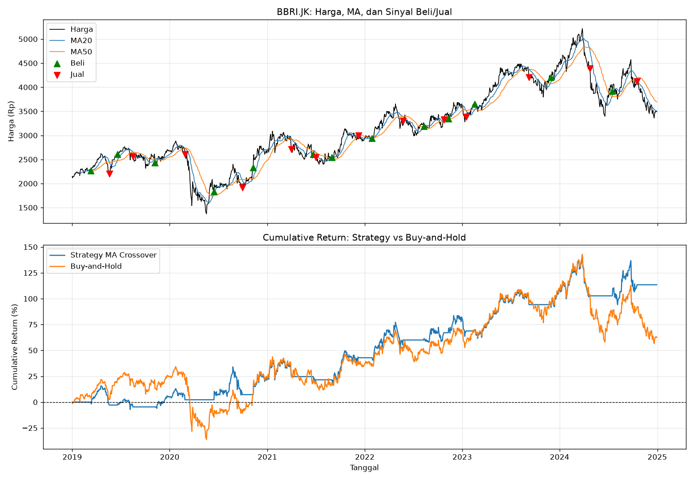
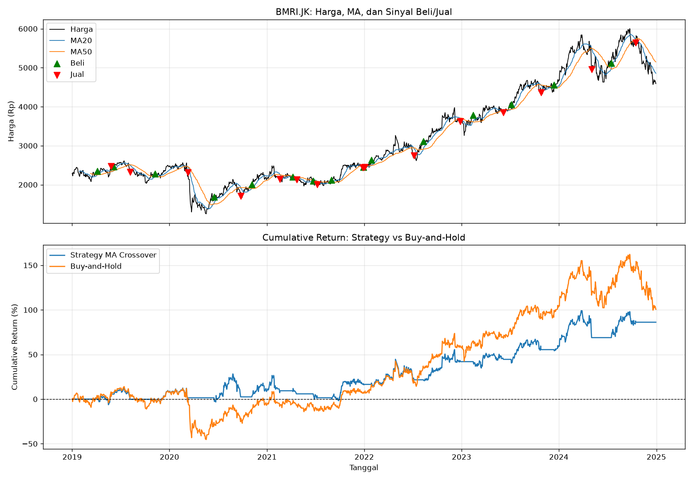
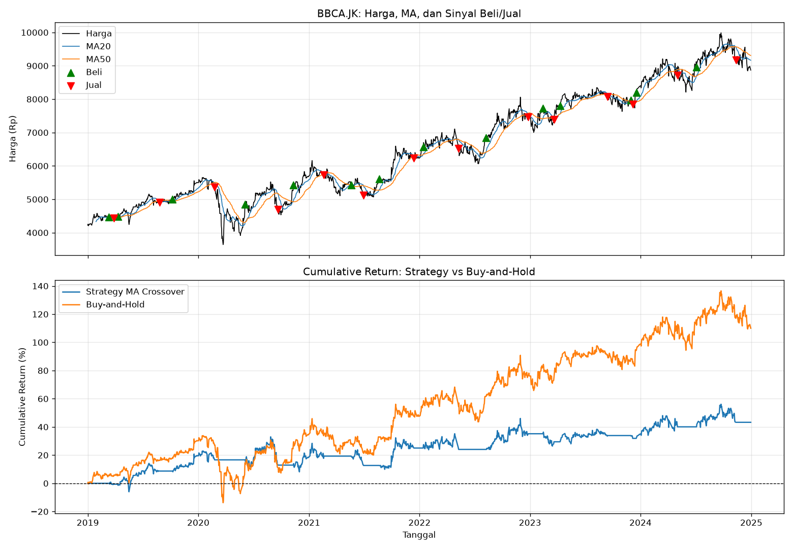

# 📉 Backtest Moving Average Crossover Strategy for Indonesian Banking Stocks

## 🎯 Project Description

This project backtests the Moving Average (MA) Crossover strategy on BBRI, BMRI and BBCA shares using Python. Buy signals appear when the short MA is above the long MA, and sell signals when the opposite is true. Strategy performance is compared with Buy-and-Hold, then retested with chronological data sharing (in-sample and out-of-sample) to see whether the results persist in never-before-seen data.

## ❓ Questions Answered

- Does the MA Crossover strategy beat Buy-and-Hold in terms of returns?
- Is this strategy more efficient (Sharpe Ratio) and safer (Max Drawdown)?
- What is the win rate and number of trades generated?
- Do the results in the in-sample data (initial 70%) still survive in the out-of-sample data (final 30%)?
- Does the MA parameter optimization result actually work in new data, or is it just overfitting?

## 🛠️ Tools & Library

- Python 3.10+
- pandas, numpy
- yfinance
- matplotlib

## 📁 Project Structure

```
ma-backtest/
├── README.md
├── requirements.txt
├── main.py
└── output/
    ├── backtest_BBRI.png
    ├── backtest_BMRI.png
    └── backtest_BBCA.png
```

## 🔍 How To Run

1. Clone this repository
   ```bash
   git clone https://github.com/username/ma-backtest-crossover.git
   ```
2. Install library
   ```bash
   pip install -r requirements.txt
   ```
3. Run backtest
   ```bash
   # three shares at once (BBRI, BMRI, BBCA) with MA20/MA50
   python main.py

   # one stock with its own parameters
   python main.py --ticker BBRI.JK --short 10 --long 30 --start 2019-01-01 --end 2024-12-31

   # look for the best MA from in-sample data, then test in out-of-sample
   python main.py --optimize
   ```

### Command Line Options

| Options | Default | Description |
|---|---|---|
| `--ticker` | Blank | Contoh `BBRI.JK`. If it is empty, it will default to BBRI, BMRI, BBCA |
| `--start` | 2019-01-01 | Data start date |
| `--end` | 2024-12-31 | Data end date |
| `--short` | 20 | Short MA period |
| `--long` | 50 | The MA period is long |
| `--optimize` | off | Choose the best MA (Sharpe in-sample), then test it out-of-sample |

## ⚙️ Methodology & Assumptions

- Signal executed in **next day** (`shift(1)`) so there is no look-ahead bias.
- Strategy for only buy or cash positions (without short selling).
- **chronological** data sharing (70% initial for in-sample, 30% final for out-of-sample), not random.
- Risk-free rate 6% per year, 252 trading days per year.
- **Transaction fees and slippage have not been calculated**, so real results are likely lower.

## 📈 Main Results

| Saham | Return Strategy | Return Buy-and-Hold | Sharpe Strategy | Sharpe BnH | Max DD Strategy | Win Rate | Jumlah Trade |
|---|---|---|---|---|---|---|---|
| BBRI | 113.45% | 62.51% | 0.44 | 0.23 | -20.26% | 76.9% | 13 |
| BMRI | 86.19% | 100.65% | 0.32 | 0.34 | -23.45% | 73.3% | 15 |
| BBCA | 43.28% | 110.01% | 0.09 | 0.40 | -18.68% | 57.1% | 14 |

- **Out-of-sample:** Sharpe Ratio strategy rose in BMRI shares from 0.22 (in-sample) to 0.62 (out-of-sample), which shows good risk adjustment performance (risk-adjusted return) in BMRI shares, so it can provide quite high returns per unit of risk covered.
- **Conclusion:** During 2019-2024, the MA Crossover strategy can provide quite good returns almost comparable to Buy-and-Hold in BMRI shares, even though the return from Buy-and-Hold is higher than MA Crossover, it can be said that the MA Crossover strategy provides quite good performance in BMRI shares.

> **Note:** If the message `[WARN]` appears when the program is running, it means that the download of yfinance failed and the program used **simulation data (not original data)**. Don't use these results for conclusions.

## 📊 Visualisasi





## ⚠️ Disclaimer

This project is educational and not an investment recommendation. Backtest results do not guarantee future performance.

## 👤 Author

Afif Ardian Saputra
